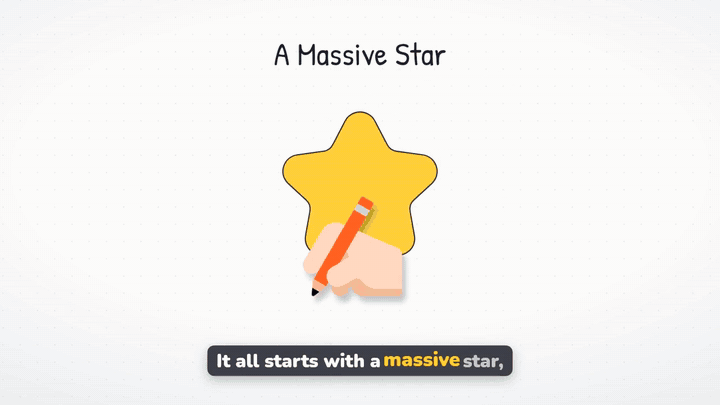

# AI Whiteboard Video Generator

[](https://github.com/genpixy-ai/ai-whiteboard-video-generator/actions/workflows/ci.yml)
[](LICENSE)
[](pyproject.toml)
[](#use-it-from-ai-agents-mcp-server-and-skill)

**Turn a topic or a script into a narrated whiteboard animation video in one command.** You get an MP4 with a hand-drawn whiteboard animation, an AI voiceover, word-by-word subtitles, background music, a thumbnail, and a ready YouTube title and description.

Use it as a **text to video** and **script to video** tool from your terminal, make a whole **faceless YouTube channel** from a topics list, run it every day with **GitHub Actions**, or let an **AI agent** (Claude, ChatGPT, Cursor, Codex) make videos through the **MCP server**.

<p align="center">
  <a href="https://www.genpixy.com/drawgen-watch?utm_source=github&utm_medium=readme&utm_campaign=ai-whiteboard-video-generator">
    
  </a>
  <br>
  <sub>Made with one command: <code>whiteboard-video make "How black holes form, explained simply for curious teenagers"</code> (62 s, 720p, unedited)</sub>
</p>

## Features

- ✍️ **Whiteboard animation from text.** A hand draws every icon, label, and diagram while the narrator talks.
- 🎨 **3 styles.** `whiteboard` (doodle and scribe video), `animate` (cartoon animation), and `flat` (color board).
- 🗣️ **AI voiceover in 76 languages.** The narration follows the language of your prompt: English, Indonesian, Spanish, Hindi, Arabic, Portuguese, and more. Male or female voice.
- 💬 **Word-by-word subtitles** burned into the video, plus an `.srt` file.
- 📱 **YouTube and Shorts formats.** Landscape 16:9 for YouTube, vertical portrait for Shorts, TikTok, and Reels. 720p or 1080p. 30 seconds to 10 minutes.
- 🏷️ **Ready to publish.** Every video comes with a thumbnail, a YouTube title, a description, and hashtags.
- 🚫 **No watermark** on videos made through the API.
- 🔁 **Safe to rerun.** Each topic maps to one video. If a run stops, run the same command again: it resumes and you never pay twice for the same topic.
- 🤖 **Agent ready.** Remote MCP server and an Agent Skills file for Claude Code, Codex, Cursor, VS Code, and Claude Desktop.

## Quick start

**1. Get an API key.** Create one at [genpixy.com → Account → API keys](https://www.genpixy.com/account/api-keys?utm_source=github&utm_medium=readme&utm_campaign=ai-whiteboard-video-generator). Videos use your GenPixy balance.

```bash
export GENPIXY_API_KEY=gpx_your_key_here
```

**2. Install** with [uv](https://docs.astral.sh/uv/) (or use `pipx`):

```bash
uv tool install git+https://github.com/genpixy-ai/ai-whiteboard-video-generator
```

**3. Make a video:**

```bash
whiteboard-video make "How black holes form, explained simply for curious teenagers"
```

The tool shows the cost and your balance, asks once, and then shows progress until the video is done:

```text
Making 1 video. Cost per video: … Balance: ….
Start? [Y/n]: y
  How black holes form, explained simply for curio ━━━━━━━━━━━━━━━━━━━ 100% done
┏━━━━━━━━━━━━━━━━━━━━━━┳━━━━━━━━┳━━━━━━━━┳━━━━━━━━━━━━━━━━━━━━━━━━━━━━━━━━━━━━━━━━━━━━━━┓
┃ Video                ┃ Result ┃ Length ┃ Folder / link                                ┃
┡━━━━━━━━━━━━━━━━━━━━━━╇━━━━━━━━╇━━━━━━━━╇━━━━━━━━━━━━━━━━━━━━━━━━━━━━━━━━━━━━━━━━━━━━━━┩
│ How Black Holes Form │ ✓ made │   63 s │ videos/how-black-holes-form-explained-simply… │
└──────────────────────┴────────┴────────┴──────────────────────────────────────────────┘
```

Each video gets its own folder:

```text
videos/how-black-holes-form-explained-simply-for-curiou-4283b762/
├── video.mp4        # the video (H.264 + AAC)
├── subtitles.srt    # subtitles
├── thumbnail.png    # thumbnail
└── video.json       # YouTube title, description, hashtags, settings, and the GenPixy link
```

More examples:

```bash
# A YouTube Short in Indonesian with a female voice
whiteboard-video make "Kenapa langit berwarna biru?" --portrait --seconds 30 --voice female

# Turn your own script into a 2-minute cartoon animation in 1080p
whiteboard-video make "$(cat script.txt)" --style animate --seconds 120 --resolution 1080p

# Check your balance and the cost of each length
whiteboard-video account
whiteboard-video prices
```

## Make many videos: faceless YouTube automation

Put your topics in a CSV file (only `prompt` is required) or a text file with one topic per line:

```csv
id,prompt,seconds,orientation,style,voice
black-holes,"How black holes form, explained simply for curious teenagers",60,landscape,whiteboard,male
photosynthesis,How plants turn sunlight into food,60,portrait,whiteboard,female
compound-interest,"Why compound interest makes money grow faster over time, with one simple example",90,landscape,flat,male
```

```bash
whiteboard-video batch topics.csv --out videos
```

- The tool checks the whole file first and lists every problem with its line number.
- Finished topics are skipped. Run the same command tomorrow with new rows, and only the new topics are made.
- `--limit 3` makes at most 3 new videos per run. `--json` prints the results as JSON for your own scripts.
- Columns: `id`, `prompt`, `seconds`, `orientation`, `resolution`, `style`, `language`, `voice`, `subtitles`, `music`, `big_board`, `zoom_dive`. Empty cells use the command-line defaults.

See [`topics.example.csv`](topics.example.csv) for a full example.

## Upload to YouTube (beta)

Install the YouTube extra and sign in once with an OAuth client from Google Cloud (YouTube Data API v3, application type "Desktop app"):

```bash
uv tool install "ai-whiteboard-video-generator[youtube] @ git+https://github.com/genpixy-ai/ai-whiteboard-video-generator"
whiteboard-video youtube login --client-secret client_secret.json
```

Then upload while you make videos, or upload finished folders later:

```bash
whiteboard-video batch topics.csv --youtube private
whiteboard-video youtube upload videos --privacy unlisted
whiteboard-video youtube upload videos/black-holes --publish-at 2026-12-01T09:00:00Z
```

The upload uses the generated YouTube title, description, hashtags, and thumbnail. A folder that is already on YouTube gets a `youtube.json` file and is never uploaded twice. Custom thumbnails need a verified YouTube channel.

## Use it from AI agents: MCP server and skill

GenPixy has a remote **MCP (Model Context Protocol) server**, so an agent can make videos with tools instead of HTTP calls.

- URL: `https://www.genpixy.com/api/mcp` (Streamable HTTP)
- Header: `Authorization: Bearer <your API key>`
- Tools: `create_video`, `get_video`, `list_videos`, `get_account`, `get_options`

```bash
# Claude Code
claude mcp add --transport http genpixy https://www.genpixy.com/api/mcp \
  --header "Authorization: Bearer $GENPIXY_API_KEY"

# Codex
codex mcp add genpixy --url https://www.genpixy.com/api/mcp --bearer-token-env-var GENPIXY_API_KEY
```

Setup for Cursor, VS Code, Claude Desktop, and other clients: [docs/mcp.md](docs/mcp.md).

**No MCP? Use the skill.** [`skills/genpixy/SKILL.md`](skills/genpixy/SKILL.md) teaches any agent that can run commands how to make videos. Install it for Claude Code:

```bash
mkdir -p ~/.claude/skills/genpixy && curl -fsSL https://www.genpixy.com/api/skill.md -o ~/.claude/skills/genpixy/SKILL.md
```

Or just paste this into your agent:

```text
Read https://www.genpixy.com/api/skill.md and make me a 60-second whiteboard video about how black holes form.
```

## Make a video every day with GitHub Actions

Copy [`examples/github-actions/daily-video.yml`](examples/github-actions/daily-video.yml) into `.github/workflows/` of your own repository, add a `topics.csv`, and add the secret `GENPIXY_API_KEY`. Every day the workflow makes the next topic, keeps the files as a workflow artifact, and remembers finished topics in git. Add the secret `YOUTUBE_TOKEN_JSON` to also upload each video to YouTube.

## All options

| Option | Values | Default |
| --- | --- | --- |
| `--seconds` | `30`, `60`, `90`, `120`, `180`, `300`, `480`, `600` | `60` |
| `--portrait` | vertical video for Shorts, TikTok, and Reels | landscape 16:9 |
| `--resolution` | `720p`, `1080p` | `720p` |
| `--style` | `whiteboard`, `animate` (cartoon), `flat` (color board) | `whiteboard` |
| `--language` | `auto` (follows the prompt), `en`, `id` | `auto` |
| `--voice` | `male`, `female` | `male` |
| `--no-subtitles` | turn off subtitles | on |
| `--no-music` | turn off background music | on |
| `--big-board` | all scenes on one board, with a zoom-out recap | off |
| `--zoom-dive` | the camera flies into an icon between scenes | off |
| `--out`, `-o` | folder for the videos | `videos` |
| `--fresh` | make a new version of a topic that was made before | off |
| `--youtube` | also upload: `private`, `unlisted`, `public` | no upload |
| `--yes`, `-y` | do not ask before starting | ask |
| `--json` | print results as JSON on stdout | off |

## Use it as a Python library

```python
from pathlib import Path

from whiteboard_video.client import GenPixyClient
from whiteboard_video.models import Orientation, VideoRequest
from whiteboard_video.videos import make_video

with GenPixyClient("gpx_...") as client:
    request = VideoRequest(prompt="How volcanoes erupt", seconds=30, orientation=Orientation.PORTRAIT)
    saved = make_video(client, request, Path("videos/volcanoes"))
    print(saved.result.youtube_title, saved.app_url)
```

The client retries network errors and busy answers with the same `Idempotency-Key`, so a retry never starts a second video. Prefer plain HTTP? See the [API docs](https://www.genpixy.com/api/docs?utm_source=github&utm_medium=readme&utm_campaign=ai-whiteboard-video-generator) and the [OpenAPI file](https://www.genpixy.com/api/openapi.json).

## FAQ

**What is a whiteboard animation video?**
An explainer video where a hand draws simple pictures on a white board while a narrator explains the topic. It is also called a doodle video, scribe video, or sketch video. It works well for lessons, explainers, and faceless YouTube channels.

**How is this different from VideoScribe or Doodly?**
In those editors you place every drawing on a timeline by hand. Here you write a topic or paste a script, and you get the whole video: drawings, voiceover, subtitles, and music. You can also make many videos from a file, or from an AI agent.

**Is it free?**
This tool is free and open source (MIT). Each video uses your GenPixy balance. Run `whiteboard-video prices` to see the cost of each length for your account. Failed or canceled videos cost nothing. To try GenPixy without the API, use the free plan on [genpixy.com](https://www.genpixy.com/?utm_source=github&utm_medium=readme&utm_campaign=ai-whiteboard-video-generator).

**Do the videos have a watermark?**
No. Videos made through the API never have a watermark.

**Which languages are supported?**
The narration follows the language of your prompt, in 76 languages. Write the prompt in Indonesian, and you get an Indonesian voiceover and Indonesian subtitles.

**How long does a video take?**
Most short videos are ready in a few minutes. Your account can make 2 videos at the same time. The batch command waits for a free slot by itself.

**Can I use my own script?**
Yes. Pass up to 5,000 characters of notes or a full script as the prompt. Line breaks and Markdown lists are fine.

## About GenPixy

GenPixy AI generates explainer whiteboard or cartoon animation videos. Perfect for faceless content creation or education.

- 🌐 Website: [genpixy.com](https://www.genpixy.com/?utm_source=github&utm_medium=readme&utm_campaign=ai-whiteboard-video-generator)
- 🎬 Example videos with their prompts: [DrawGen Watch](https://www.genpixy.com/drawgen-watch?utm_source=github&utm_medium=readme&utm_campaign=ai-whiteboard-video-generator)
- 📘 API docs: [genpixy.com/api/docs](https://www.genpixy.com/api/docs?utm_source=github&utm_medium=readme&utm_campaign=ai-whiteboard-video-generator)

## Development

```bash
uv sync --all-extras
uv run pytest -q
uv run ruff check && uv run basedpyright
```

Issues and pull requests are welcome.

## License

[MIT](LICENSE)
